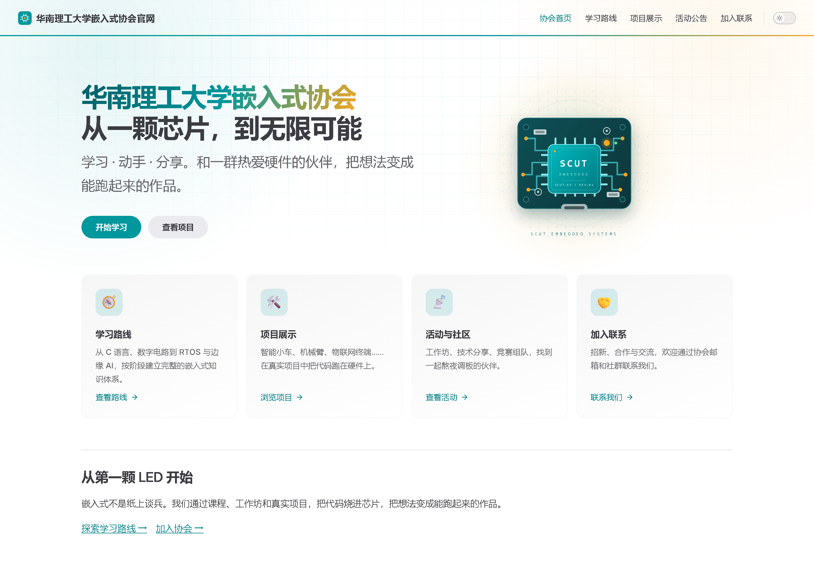

# 华南理工大学嵌入式协会官网

基于 VitePress 的协会官网项目。

GitHub 仓库：https://github.com/SCUT-ESA/scut-embedded-association-website



## 协作说明

- 人类贡献者请阅读 [CONTRIBUTING.md](./CONTRIBUTING.md)
- AI 编程助手请阅读 [AGENTS.md](./AGENTS.md)

## 本地开发

```bash
npm install
npm run docs:dev
```

默认访问地址：`http://localhost:5173/`

## 构建与预览

```bash
npm run docs:build
npm run docs:preview
```

构建产物位于 `docs/.vitepress/dist/`。

## GitHub Pages 部署

仓库已包含 `.github/workflows/deploy.yml`，推送到 `main` 后会自动构建并部署。

第一次使用时，需要先在 GitHub 仓库中手动启用 Pages：

```text
Settings → Pages → Build and deployment → Source: GitHub Actions
```

启用后进入 `Actions`，找到 `Deploy VitePress site to Pages`，点击 `Re-run all jobs`。

部署完成后地址为：

```text
https://scut-esa.github.io/scut-embedded-association-website/
```

如果以后绑定自定义域名，需要把 `VITEPRESS_BASE` 改为 `/`，并配置 DNS 和 `Custom domain`。

## 目录说明

```text
docs/
├─ .vitepress/config.mjs    # 站点标题、导航和主题配置
├─ .vitepress/theme/        # Arduino 风格配色与首页样式
├─ public/                  # Logo、首页插画等静态资源
├─ index.md                 # 协会首页
├─ learn.md                 # 学习路线
├─ projects.md              # 项目展示
├─ events.md                # 活动公告
└─ contact.md               # 加入联系
```
